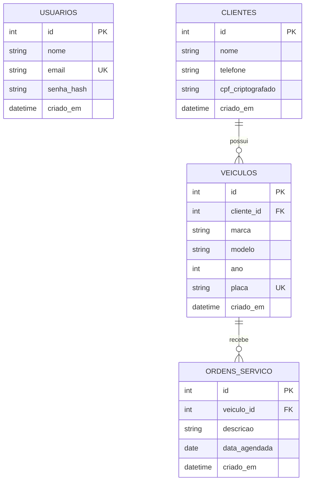

# Requisitos — Oficina Bortolotto

> Este documento descreve o escopo pedido para o MVP. Os arquivos SQL e o código da aplicação são a implementação; esta documentação não adiciona funcionalidades ao sistema.

## 1. Requisitos funcionais

- **RF01 — Autenticação (HU-06, HU-07, HU-08):** autenticar por e-mail e senha e emitir token JWT com validade de duas horas.
- **RF02 — Sessão (HU-09, HU-10, HU-11):** exibir o nome do usuário, permitir sair e encerrar a sessão local ao receber HTTP 401.
- **RF03 — Clientes (HU-12, HU-13, HU-14, HU-16):** listar, pesquisar por nome, cadastrar, editar e excluir clientes.
- **RF04 — Segurança (HU-15):** armazenar senhas com bcrypt e CPFs cifrados simetricamente com AES-256-GCM; decifrar CPF somente no backend para a tela autenticada.
- **RF05 — Veículos (HU-17):** cadastrar veículo associado a um cliente existente.
- **RF06 — Ordens de serviço (HU-18, HU-19):** listar OS por data com dados do cliente e veículo e permitir remarcar a data.
- **RF07 — Dados (HU-04, HU-05):** persistir usuários, clientes, veículos e ordens de serviço com chaves primárias e relacionamentos entre cliente, veículo e OS.

## 2. Infraestrutura e tecnologias

- **Frontend:** React.js com JavaScript e Vite.
- **Backend:** Node.js com Express e JavaScript.
- **Banco de dados:** SQLite pelo módulo integrado `node:sqlite` (Node.js 22.13 ou superior).
- **Autenticação:** JWT, com expiração em duas horas.
- **Proteção:** bcrypt para senhas; `crypto` nativo, AES-256-GCM, para CPF.
- **Comunicação:** API REST local; frontend em `localhost:5173`, API em `localhost:3001`.

## 3. Diagrama de Entidade-Relacionamento

## 4. Inicialização

Consulte o [README](README.md) para instalar dependências, configurar segredos, inicializar o SQLite e executar frontend e backend. O seed contém três usuários, clientes, veículos e ordens de serviço fictícios. As contas de demonstração usam a senha `Oficina123!`.
